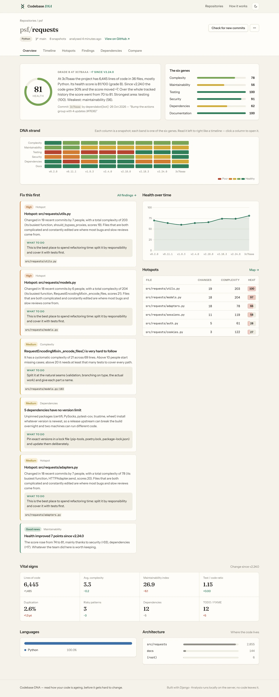
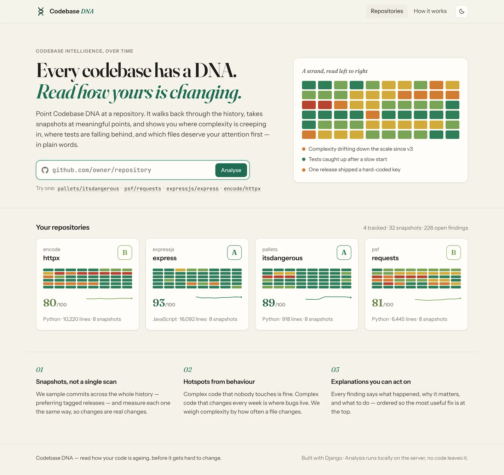
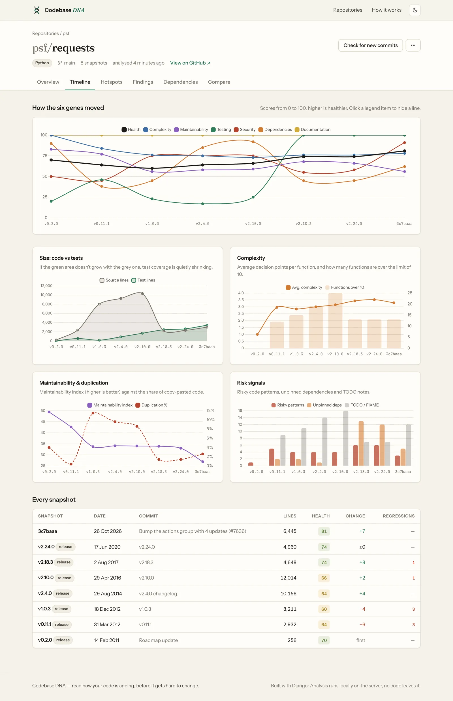
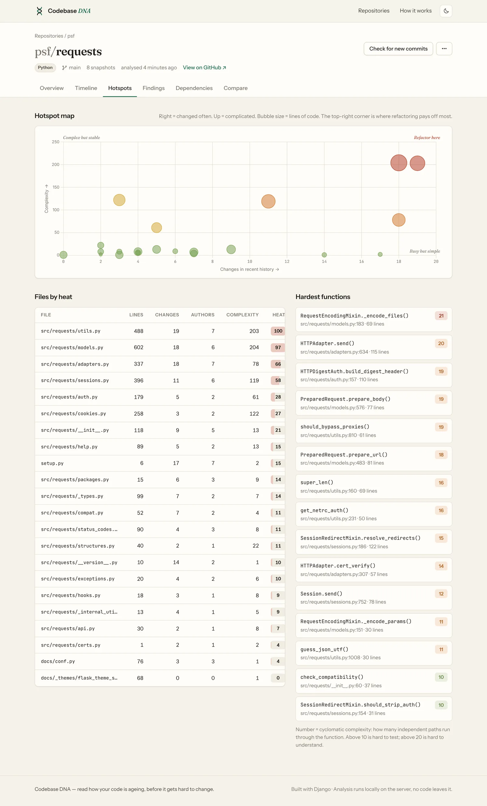
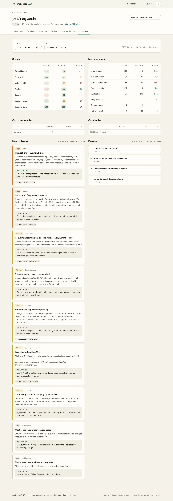
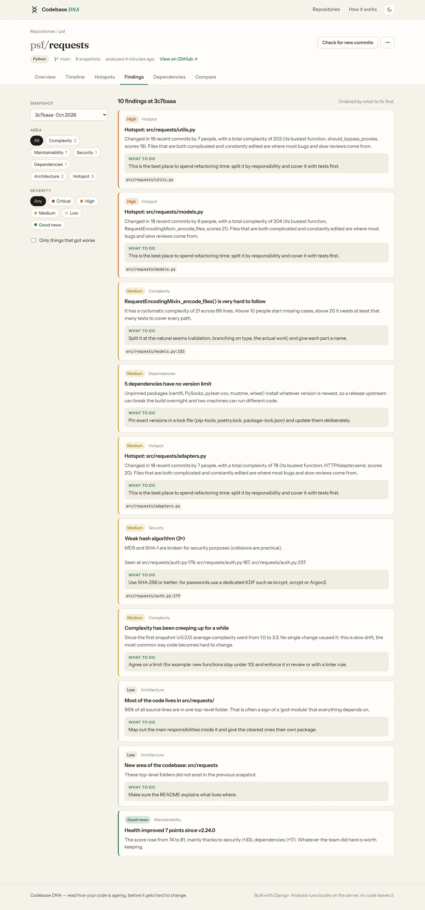
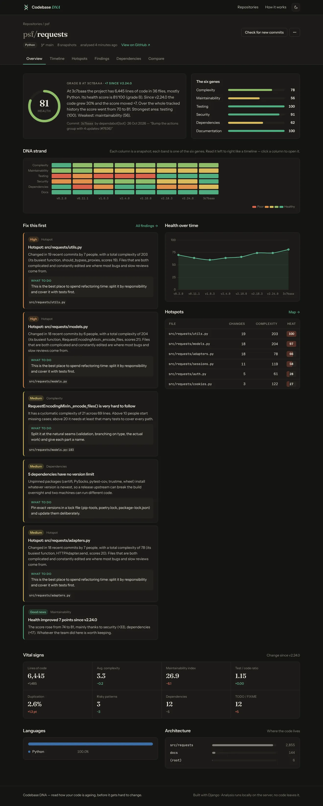

# Codebase DNA

**Codebase DNA** analyses a GitHub repository and tracks how its architecture, complexity,
maintainability, testing, security and dependencies change over time.

Most code-quality tools give you a single scan of how a project looks *today*. Codebase DNA
walks back through the git history, takes snapshots at meaningful points (preferring tagged
releases), measures each one the same way, and compares them. The result is a *DNA profile*
of the project: which parts are getting harder to change, why, and what to fix first.



## What it does

| | |
|---|---|
| **Historical snapshots** | Up to 8 commits sampled across the whole history (configurable). Tagged releases are preferred when they sit near a sample point. Re-runs only analyse new commits. |
| **Six "genes"** | Complexity, Maintainability, Testing, Security, Dependencies and Documentation, each scored 0–100, plus a weighted health score and an A–E grade. |
| **DNA strand** | One column per snapshot, one coloured band per gene, so you can see the whole history at a glance. |
| **Hotspots** | Files that are both complex *and* changed often (from `git log`), shown as a churn × complexity map. That's where refactoring pays off most. |
| **Findings in plain English** | Each one says what happened, why it matters and what to do. Regressions are flagged, and the list is ordered by priority. |
| **Compare** | Pick any two snapshots and see score changes, measurement changes, files that got more or less complex, new problems and resolved ones. |
| **Dependency risk** | Parses `requirements*.txt`, `pyproject.toml`, `Pipfile`, `package.json`, `go.mod`, `Cargo.toml` and `Gemfile`. Flags unpinned and known-abandoned packages. |
| **Security patterns** | Leaked credentials and keys, `eval`/`exec`, `shell=True`, SQL built with string formatting, disabled TLS checks, unsafe `pickle`/`yaml`, weak hashes, XSS sinks and more. |
| **JSON API** | `/api/r/<slug>.json` returns the whole profile for scripts and dashboards. |

Languages: Python is parsed exactly with `ast`. JavaScript, TypeScript, Java, Kotlin, Go, Rust,
C, C++, C#, PHP, Swift, Scala and Dart are analysed by stripping comments and strings and
matching braces. Ruby, Shell, Lua and Elixir get line counts and keyword-based complexity.

## Quick start

```bash
python -m venv .venv
source .venv/bin/activate          # Windows: .venv\Scripts\activate
pip install -r requirements.txt
python manage.py migrate
python manage.py runserver
```

Open <http://127.0.0.1:8000>, paste a repository such as `pallets/itsdangerous` or
`https://github.com/psf/requests`, and the page fills in as the analysis runs.

You need `git` on the PATH. Nothing else is required: there are no external services, the
fonts and Chart.js are bundled, and the app works offline for repositories you have locally.

### From the command line

```bash
python manage.py analyze_repo pallets/flask
python manage.py analyze_repo https://github.com/expressjs/express --snapshots 10
python manage.py analyze_repo ~/code/my-project          # a local git folder
python manage.py analyze_repo psf/requests --rebuild     # throw away old snapshots first
```

### Tests

```bash
python manage.py test dna
```

The suite builds a small git repository on the fly, analyses it end to end, and renders every page.

## Configuration

All settings are environment variables:

| Variable | Default | Meaning |
|---|---|---|
| `DJANGO_SECRET_KEY` | dev key | Set this in production. |
| `DJANGO_DEBUG` | `True` | Set to `False` in production. |
| `DJANGO_ALLOWED_HOSTS` | `localhost,127.0.0.1,[::1]` | Comma-separated. |
| `DNA_WORKDIR` | `.dna-workdir/` | Where repositories are cloned. |
| `DNA_MAX_SNAPSHOTS` | `8` | Points in history per analysis. |
| `DNA_MAX_FILE_BYTES` | `400000` | Bigger files (bundles, data dumps) are skipped. |
| `DNA_ASYNC` | `True` | Run analyses in a background thread. |
| `DNA_ALLOW_LOCAL_PATHS` | same as `DEBUG` | Allow local folders in the web form. |

## How it works

```
 GitHub URL ──► clone (blob-less) ──► first-parent history ──► sample commits
                                                                   │
              ┌────────────────────────────────────────────────────┘
              ▼   for each sampled commit
   checkout ─► collect files ─► per-file analysis ─► security scan ─► dependency parse
                                  (ast / brace matcher)                     │
                                                                            ▼
     git log churn ─► hotspot score ─► aggregate ─► 6 scores + health ─► insight rules
                                                                            │
                                                         Snapshot, FileMetric, Finding rows
```

```
config/                 Django project (settings, urls)
dna/
  analyzer/
    git.py              clone, history, sampling, checkout, churn
    languages.py        file types, ignored folders, test detection
    source.py           per-file metrics: LOC, functions, complexity, nesting, MI
    security.py         risky-pattern rules
    dependencies.py     manifest parsers and pinning/risk judgement
    collector.py        walks a tree, finds duplication
    scoring.py          measurements -> 0..100 scores
    insights.py         snapshot vs previous -> explained findings
    pipeline.py         orchestration + background runs
  models.py             Repository, AnalysisRun, Snapshot, FileMetric, Finding
  views.py / urls.py    pages and JSON endpoints
  templates/dna/        server-rendered UI
  static/dna/           CSS, JS, bundled fonts and Chart.js
  tests/                unit and end-to-end tests
```

### Scoring

| Gene | Weight | Built from |
|---|---|---|
| Complexity | 20% | Average cyclomatic complexity per function, share of functions above 10, deepest nesting |
| Maintainability | 20% | Maintainability index, duplication, very large files, very long functions |
| Testing | 20% | Test lines ÷ source lines, CI present |
| Security | 20% | Risky patterns weighted by severity per KLOC. Any critical finding caps the score at 45 |
| Dependencies | 10% | Unpinned share, known-risky packages, total count |
| Documentation | 10% | README and its length, comment density, licence |

Grades: A ≥ 85, B ≥ 70, C ≥ 55, D ≥ 40, E below.

The thresholds live in `dna/analyzer/scoring.py`. They are heuristics chosen to be *consistent
across snapshots*, so trends are meaningful even where an absolute number is debatable.

## Screenshots

| | |
|---|---|
|  |  |
|  |  |
|  |  |

## Limitations

- Analysis is static and heuristic. It is not a compiler, a coverage tool or a CVE database.
- Private repositories need git credentials available to the server process.
- Background work uses a thread, which is fine for a single server. For heavy use, move
  `pipeline.execute` onto a task queue such as Celery or RQ.
